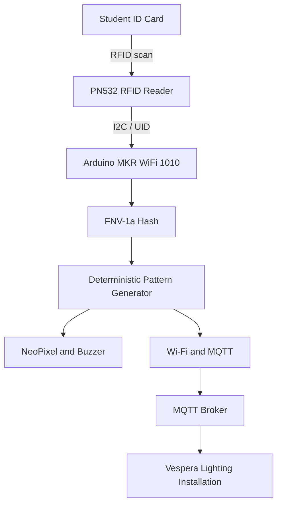

# CASA0014 — RFID-to-Light Interface for Vespera

## Project Overview

This project explores how a familiar everyday object — a university student ID card — can become an interface for interacting with a connected lighting installation.

I developed a physical prototype using an Arduino MKR WiFi 1010 and a PN532 RFID reader. When a student taps their card, the device reads its unique identifier (UID) and transforms it into a repeatable sequence of five colours and durations.

The device provides immediate local feedback through an LED, a NeoPixel and a buzzer. It also sends lighting commands over MQTT to Vespera, a connected lighting installation at University College London (UCL).

The same card generates the same lighting sequence each time, creating a consistent relationship between a physical identity token and a visual output.

## Project Aim

The aim is to investigate how RFID sensing, embedded computing and network communication can turn a simple physical interaction into a shared visual experience.

Rather than displaying personal information, the prototype uses the card's UID as an input to generate a deterministic lighting pattern.

## Hardware Components

The prototype uses the following hardware:

| Component | Purpose |
|---|---|
| Arduino MKR WiFi 1010 | Main microcontroller, responsible for processing RFID inputs and communicating with the Vespera installation over Wi-Fi and MQTT. |
| PN532 RFID reader | Detects student cards and reads their unique identifiers (UIDs) using I2C communication. |
| NeoPixel RGB LED | Displays colour feedback generated from the scanned card. |
| Piezo buzzer | Provides audible feedback during interaction. |
| Jumper wires and connecting components | Connect the electronic components to the Arduino. |
| Repurposed AirPods Pro cardboard box | Houses the prototype and provides a compact physical enclosure. |

### Physical Design

The electronics are housed inside a repurposed AirPods Pro cardboard box. This approach allowed me to create a compact prototype using an existing object rather than fabricating a new enclosure.

The enclosure brings the RFID reader, NeoPixel and buzzer together into a single physical interface. Photographs of the assembled electronics and enclosure are available in the [`images`](images/) folder.

## How the System Works

The prototype converts a student card scan into a repeatable lighting sequence that is transmitted to the Vespera installation at UCL.

### Interaction Process

1. **RFID detection:** A student places their university card near the PN532 reader, which reads the card's unique identifier (UID).
2. **UID processing:** The Arduino processes the UID using an FNV-1a hash function to generate a numerical seed.
3. **Pattern generation:** A deterministic pseudo-random algorithm uses this seed to generate a sequence of five colour and duration combinations.
4. **Local feedback:** The NeoPixel and buzzer provide immediate feedback to the person interacting with the prototype.
5. **Network communication:** The Arduino connects to the MQTT broker over Wi-Fi and publishes lighting commands to the Vespera installation.
6. **Physical output:** Vespera receives the commands and displays the generated colours through its lighting system.

### Deterministic Lighting Patterns

A key design decision was to make the lighting patterns deterministic. This means that scanning the same card produces the same sequence of colours and durations.

The UID is used as the input to a hashing and pseudo-random generation process, rather than simply selecting a completely new random pattern for every interaction.

Each sequence contains five steps, using a palette of eight colours and durations of either 300 or 700 milliseconds. The algorithm also avoids repeating the same colour in consecutive steps.

Different cards may occasionally produce the same sequence, so these patterns should not be considered unique identifiers or secure authentication mechanisms.

### MQTT Communication

The Arduino communicates with Vespera using MQTT, a lightweight publish–subscribe messaging protocol commonly used in Internet of Things systems.

For each generated colour, the Arduino publishes an RGB lighting payload to the designated Vespera MQTT topic. This allows a physical RFID interaction at the prototype to control a separate network-connected lighting installation.

The Wi-Fi and MQTT credentials are stored separately in `arduino_secrets.h`, which is not included in the public repository.

## System Architecture

The diagram below illustrates how a student card interaction is processed locally and transmitted to the Vespera installation.

The PN532 reads the card UID and sends it to the Arduino over I2C. The Arduino converts the UID into a deterministic five-step lighting sequence.

The generated pattern provides local feedback through the NeoPixel and buzzer, while RGB lighting commands are published through MQTT to control the remote Vespera installation.

This separates the physical interaction, local computation, network communication and remote lighting output into distinct parts of the system.

## Wiring Diagram

The diagram below illustrates the connections between the Arduino MKR WiFi 1010, PN532 RFID reader, NeoPixel RGB LED and buzzer.

### Wiring Connections

| Component | Component pin | Arduino MKR WiFi 1010 connection |
|---|---|---|
| PN532 RFID reader | VCC | VCC |
| PN532 RFID reader | GND | GND |
| PN532 RFID reader | SDA | SDA |
| PN532 RFID reader | SCL | SCL |
| NeoPixel RGB LED | 5V | 5V |
| NeoPixel RGB LED | DI (Data In) | Digital pin 6 |
| NeoPixel RGB LED | GND | GND |
| Buzzer | Positive (+) | Digital pin 5 |
| Buzzer | Negative (−) | GND |

**Technical notes:** The PN532 communicates with the Arduino through I2C using SDA and SCL. All components share a common ground.

The Arduino MKR WiFi 1010 uses 3.3V logic. The NeoPixel is powered from 5V, so a suitable logic-level shifter is recommended for reliable operation. The buzzer must also be compatible with the Arduino's voltage and current limits.

The wiring diagram is an illustrative overview; the connection table records the connections used in the prototype. The PN532 module's supply-voltage requirements should be checked against its specifications.
