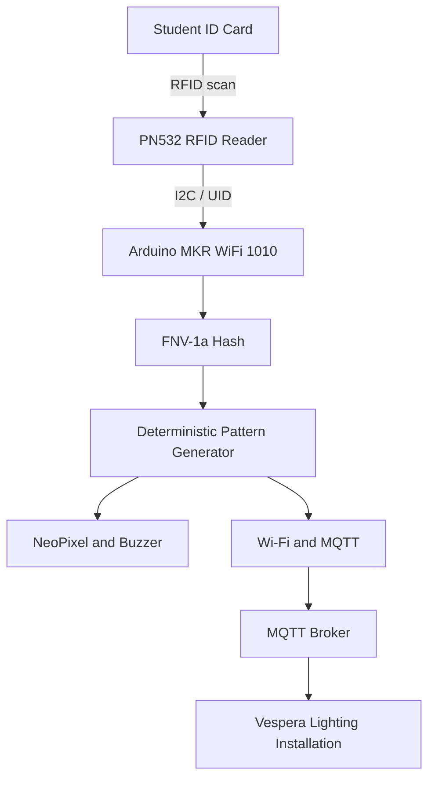
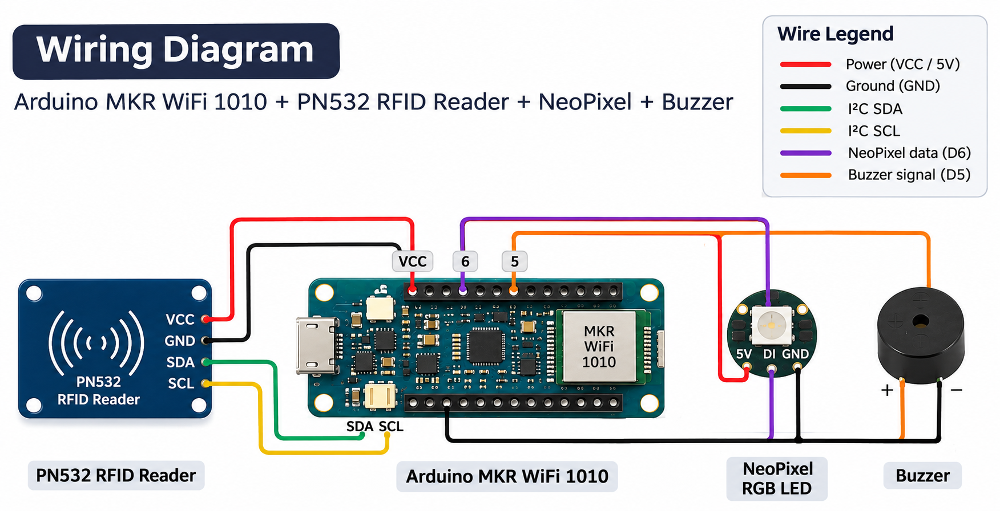
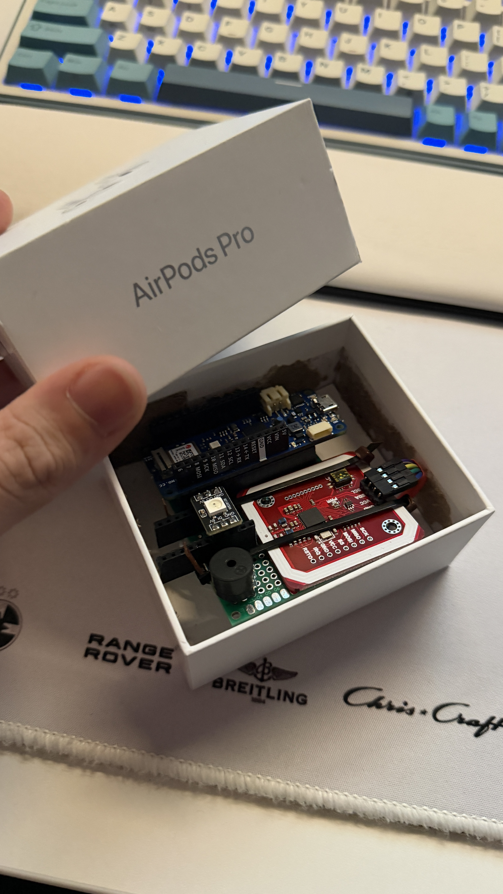
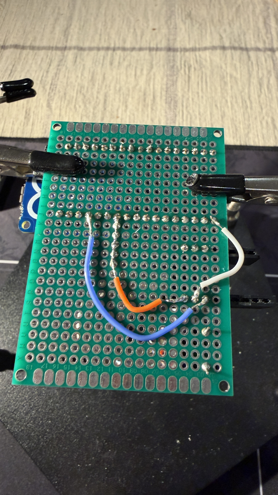
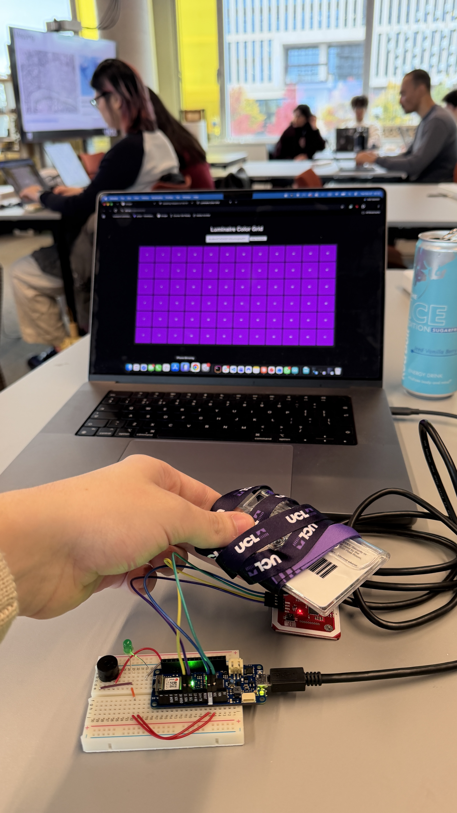
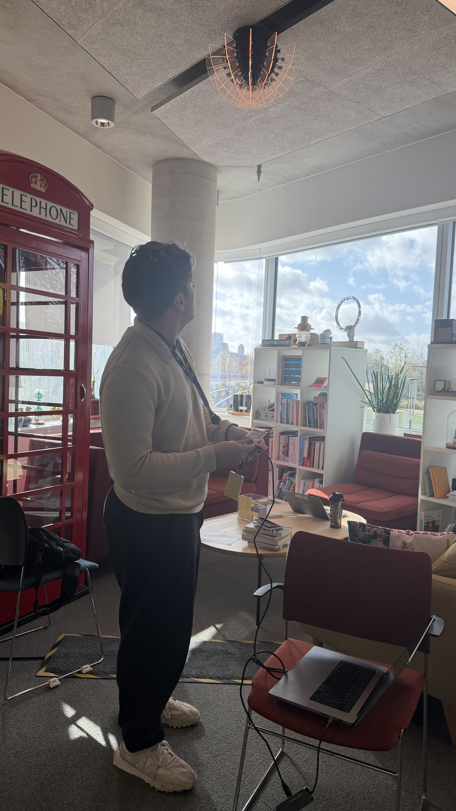

# CASA0014 — RFID-to-Light Interface for Vespera

## Table of Contents

- [Project Overview](#project-overview)
- [Current Working Version](#current-working-version)
- [Project Aim](#project-aim)
- [Hardware Components](#hardware-components)
- [Physical Design](#physical-design)
- [How the System Works](#how-the-system-works)
  - [Interaction Process](#interaction-process)
  - [Deterministic Lighting Patterns](#deterministic-lighting-patterns)
  - [MQTT Communication](#mqtt-communication)
- [System Architecture](#system-architecture)
- [Wiring Diagram](#wiring-diagram)
  - [Wiring Connections](#wiring-connections)
- [Testing and Validation](#testing-and-validation)
- [Development and Iteration](#development-and-iteration)
- [Software Setup and Reproduction](#software-setup-and-reproduction)
- [Prototype Gallery](#prototype-gallery)
- [Acknowledgements](#acknowledgements)

## Project Overview

This project explores how a familiar everyday object — a university student ID card — can become an interface for interacting with a connected lighting installation.

I developed a physical prototype using an Arduino MKR WiFi 1010 and a PN532 RFID reader. When a student taps their card, the device reads its unique identifier (UID) and transforms it into a repeatable sequence of five colours and durations.

The device provides immediate local feedback through a NeoPixel RGB LED and a buzzer. It also sends lighting commands over MQTT to Vespera, a connected lighting installation at University College London (UCL).

The same card generates the same lighting sequence each time, creating a consistent relationship between a physical identity token and a visual output.

### Current Working Version

**Version 3 is the latest tested version of the prototype.**

It has been tested with the Arduino hardware and Vespera lighting installation. The earlier versions are retained to document the development and debugging process.

The prototype generates a repeatable five-step colour pattern from an RFID card and provides local feedback through the NeoPixel and buzzer.

## Project Aim

The aim is to investigate how RFID sensing, embedded computing and network communication can turn a simple physical interaction into a shared visual experience.

Rather than displaying personal information, the prototype uses the card's UID as an input to generate a deterministic lighting pattern.

## Hardware Components

The prototype uses the following hardware:

| Component | Purpose |
|---|---|
| Arduino MKR WiFi 1010 | Main microcontroller, responsible for processing RFID inputs and communicating with the Vespera installation over Wi-Fi and MQTT. |
| PN532 RFID reader | Detects student cards and reads their unique identifiers (UIDs) using I2C communication. |
| NeoPixel RGB LED | Displays colour feedback generated from the scanned card. |
| Piezo buzzer | Provides audible feedback during interaction. |
| Jumper wires and connecting components | Connect the electronic components to the Arduino. |
| Repurposed AirPods Pro cardboard box | Houses the prototype and provides a compact physical enclosure. |

### Physical Design

The electronics are housed inside a repurposed AirPods Pro cardboard box. This approach allowed me to create a compact prototype using an existing object rather than fabricating a new enclosure.

The enclosure brings the RFID reader, NeoPixel and buzzer together into a single physical interface. Photographs of the assembled electronics and enclosure are available in the [`images`](images/) folder.

## How the System Works

The prototype converts a student card scan into a repeatable lighting sequence that is transmitted to the Vespera installation at UCL.

### Interaction Process

1. **RFID detection:** A student places their university card near the PN532 reader, which reads the card's unique identifier (UID).
2. **UID processing:** The Arduino processes the UID using an FNV-1a hash function to generate a numerical seed.
3. **Pattern generation:** A deterministic pseudo-random algorithm uses this seed to generate a sequence of five colour and duration combinations.
4. **Local feedback:** The NeoPixel and buzzer provide immediate feedback to the person interacting with the prototype.
5. **Network communication:** The Arduino connects to the MQTT broker over Wi-Fi and publishes lighting commands to the Vespera installation.
6. **Physical output:** Vespera receives the commands and displays the generated colours through its lighting system.

### Deterministic Lighting Patterns

A key design decision was to make the lighting patterns deterministic. This means that scanning the same card produces the same sequence of colours and durations.

The UID is used as the input to a hashing and pseudo-random generation process, rather than simply selecting a completely new random pattern for every interaction.

Each sequence contains five steps, using a palette of eight colours and durations of either 300 or 700 milliseconds. The algorithm also avoids repeating the same colour in consecutive steps.

Different cards may occasionally produce the same sequence, so these patterns should not be considered unique identifiers or secure authentication mechanisms.

### MQTT Communication

The Arduino communicates with Vespera using MQTT, a lightweight publish–subscribe messaging protocol commonly used in Internet of Things systems.

For each generated colour, the Arduino publishes an RGB lighting payload to the designated Vespera MQTT topic. This allows a physical RFID interaction at the prototype to control a separate network-connected lighting installation.

The Wi-Fi and MQTT credentials are stored separately in `arduino_secrets.h`, which is not included in the public repository.

## System Architecture

The diagram below illustrates how a student card interaction is processed locally and transmitted to the Vespera installation.

The PN532 reads the card UID and sends it to the Arduino over I2C. The Arduino converts the UID into a deterministic five-step lighting sequence.

The generated pattern provides local feedback through the NeoPixel and buzzer, while RGB lighting commands are published through MQTT to control the remote Vespera installation.

This separates the physical interaction, local computation, network communication and remote lighting output into distinct parts of the system.

## Wiring Diagram

The diagram below illustrates the connections between the Arduino MKR WiFi 1010, PN532 RFID reader, NeoPixel RGB LED and buzzer.

### Wiring Connections

| Component | Component pin | Arduino MKR WiFi 1010 connection |
|---|---|---|
| PN532 RFID reader | VCC | VCC |
| PN532 RFID reader | GND | GND |
| PN532 RFID reader | SDA | SDA |
| PN532 RFID reader | SCL | SCL |
| NeoPixel RGB LED | 5V | 5V |
| NeoPixel RGB LED | DI (Data In) | Digital pin 6 |
| NeoPixel RGB LED | GND | GND |
| Buzzer | Positive (+) | Digital pin 5 |
| Buzzer | Negative (−) | GND |

**Technical notes:** The PN532 communicates with the Arduino through I2C using SDA and SCL. All components share a common ground.

The Arduino MKR WiFi 1010 uses 3.3V logic. The NeoPixel is powered from 5V, so a suitable logic-level shifter is recommended for reliable operation. The buzzer must also be compatible with the Arduino's voltage and current limits.

The wiring diagram is an illustrative overview; the connection table records the connections used in the prototype. The PN532 module's supply-voltage requirements should be checked against its specifications.

## Testing and Validation

Testing was carried out to evaluate whether the RFID prototype behaves consistently and successfully communicates with the Vespera installation.

### Test 1 — Repeatability of RFID-Generated Patterns

**Objective:** Verify that scanning the same RFID card multiple times produces the same lighting sequence.

**Method:** Scan the same student card twice and compare the resulting five-step colour sequences.

**Observed result:** Both scans produced the same lighting sequence.

**Outcome:** Pass.

**Interpretation:** This result is consistent with the intended deterministic behaviour of the pattern-generation algorithm. It demonstrates repeatability for the card tested, although further testing with additional cards would be needed to assess the system more broadly.

### Test 2 — Variation Between Different RFID Cards

**Objective:** Investigate whether different student cards generate different lighting patterns.

**Method:** Scan two different student cards and compare the resulting colour sequences.

**Observed result:** The two cards produced different colours.

**Outcome:** Pass.

**Interpretation:** This observation supports the intended behaviour of using the RFID UID to influence the generated lighting pattern. Combined with Test 1, it suggests that the prototype can produce repeatable but varied visual outputs depending on the card scanned.

**Limitation:** This test does not establish that every card generates a unique pattern. Different UIDs may occasionally produce identical sequences.

### Test 3 — End-to-End MQTT Communication with Vespera

**Objective:** Verify that scanning an RFID card on the physical prototype can control the Vespera lighting installation at UCL.

**Method:** Connect the Arduino MKR WiFi 1010 to the Wi-Fi network and MQTT broker, scan a student card using the PN532 reader, and observe the response of the Vespera installation.

**Observed result:** The Vespera installation responded to the RFID scan by displaying the generated lighting colours.

**Outcome:** Pass.

**Interpretation:** This confirms that the complete interaction worked during testing: RFID detection, local pattern generation, Wi-Fi communication, MQTT message transmission and remote lighting output.

**Photographic evidence:** Photographs of the prototype and the Vespera installation during testing are available in the [`images`](images/) folder.

**Limitation:** This successful test does not establish long-term network reliability or behaviour during Wi-Fi or MQTT disconnections.

## Development and Iteration

The Arduino code was developed through three versions, with testing used to identify problems and improve the prototype.

### Version 1 — Initial Working Prototype

The first version established the core interaction: reading an RFID card, generating a five-step lighting sequence, providing local feedback and sending lighting commands to Vespera through MQTT.

### Version 2 — Code Simplification

The second version reorganised and simplified the Arduino sketch, including removing functionality associated with the external green LED used during early testing.

During testing, I observed that scanning the same card appeared to produce different lighting sequences. This was inconsistent with the project's goal of generating repeatable patterns.

### Version 3 — Updated and Tested Prototype

The third version introduced additional Serial Monitor output to display the card information and generated colour sequence, making the system easier to inspect and troubleshoot.

I tested this version on the physical prototype and confirmed that it operated successfully with the Vespera installation.

### Lessons from Iteration

This development process highlighted the importance of testing after refactoring code. A program compiling successfully does not necessarily mean that its behaviour is correct. Testing the complete interaction, from RFID scanning to physical lighting output, was essential for evaluating the revised prototype.

## Software Setup and Reproduction

### Requirements

The prototype was developed using the Arduino IDE and an Arduino MKR WiFi 1010.

The following Arduino libraries are required:

| Library | Purpose |
|---|---|
| WiFiNINA | Connects the Arduino to a Wi-Fi network |
| PubSubClient | Communicates with the MQTT broker |
| Adafruit PN532 | Reads RFID cards through the PN532 module |
| Adafruit NeoPixel | Controls the local RGB LED |

The sketch also uses the Arduino `Wire` library for I2C communication.

### Installation

1. Install the Arduino IDE.
2. Open **Tools → Board → Boards Manager** and install **Arduino SAMD Boards (32-bits ARM Cortex-M0+)**.
3. Select **Arduino MKR WiFi 1010** as the board.
4. Open **Sketch → Include Library → Manage Libraries** and install the required libraries.
5. Open the latest tested Arduino sketch from this repository.
6. Copy arduino_secrets.example.h into the Arduino sketch folder, rename the copy to arduino_secrets.h, and replace the placeholders with your own authorised settings.
7. Connect the Arduino MKR WiFi 1010 to your computer using USB.
8. Select the correct serial port and upload the sketch.
9. Open the Serial Monitor at **115200 baud** to observe RFID scans and generated lighting patterns.

### Network Configuration

The prototype uses Wi-Fi and MQTT to communicate with the Vespera lighting installation.

Connection settings and credentials are stored separately from the main Arduino sketch to avoid exposing sensitive information.

The MQTT connection uses an authorised university network and lighting installation. Access details are not provided publicly.

Users can reproduce the local RFID interaction, colour generation, NeoPixel feedback and buzzer behaviour without access to the Vespera installation. Remote lighting functionality requires appropriate network access and authorisation.

### Testing the Prototype

After uploading the sketch, place an RFID card near the PN532 reader.

The device should read the card, provide local feedback through the NeoPixel and buzzer, and generate a five-step lighting pattern.

When connected to the authorised Vespera MQTT network, the prototype should also transmit the lighting commands to the installation.

Scanning the same card again should reproduce the same pattern.

## Prototype Gallery

The images below document the physical prototype, its hardware integration and its interaction with the Vespera lighting installation.

### Finished Prototype

*The completed RFID interaction device housed in a repurposed AirPods Pro box.*

### Hardware Assembly

*Arduino MKR WiFi 1010, PN532 RFID reader and other components inside the enclosure.*

### RFID Interaction

*Presenting a student card to the reader to trigger a deterministic lighting sequence.*

### Vespera Lighting Response

*The Vespera installation responding to lighting commands transmitted from the prototype.*

## Acknowledgements

This project was developed as part of the CASA0014 *Prototyping the Internet of Things* module at University College London (UCL).

Generative AI tools, including ChatGPT (OpenAI), were used to support the development and documentation of this project.

**Code development:** AI assistance was used to help write, simplify, debug and explain parts of the Arduino code. The resulting code was implemented and tested on the physical prototype, including its interaction with the Vespera lighting installation.

**Documentation:** AI assistance was used to improve the clarity, structure, grammar and presentation of the GitHub README. The project descriptions, hardware implementation, testing observations and development process are based on the work carried out during this project.

**Responsibility:** I reviewed the AI-assisted outputs and take responsibility for the final implementation, documentation and submitted work.

Thank You!
